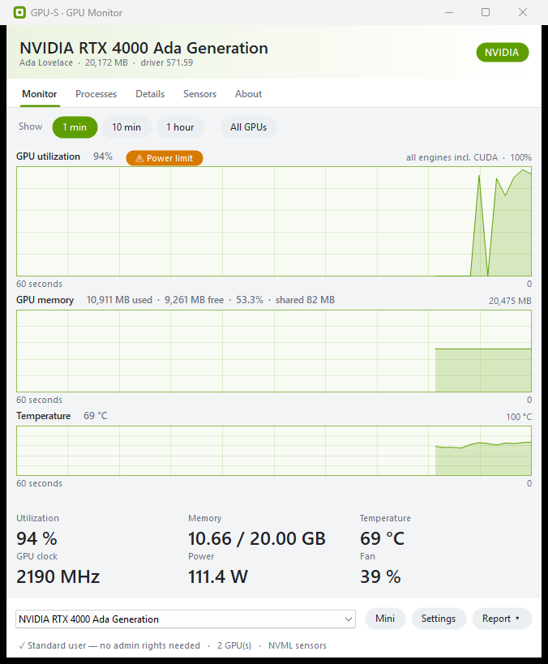
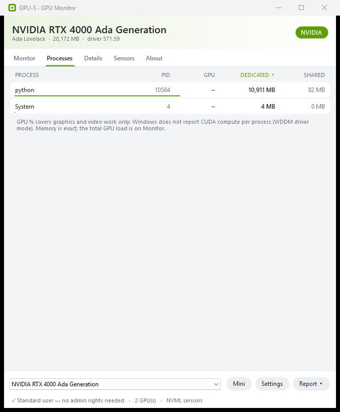
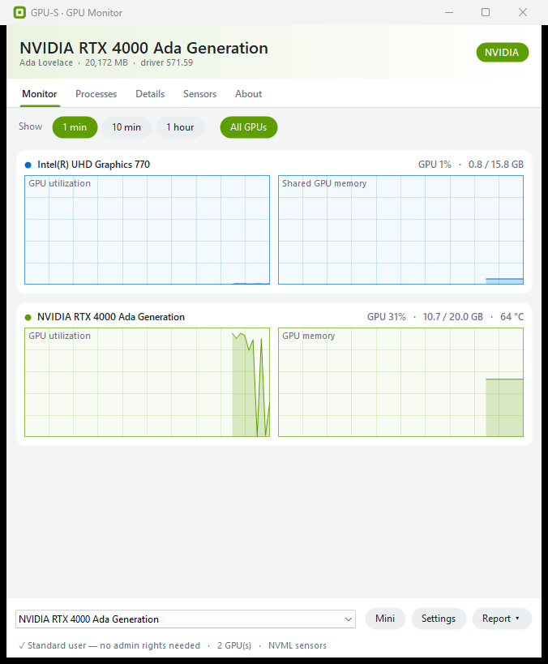
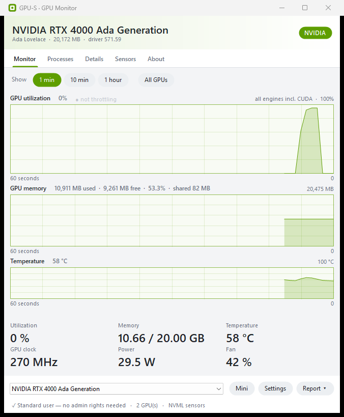

# GPU-S: a GPU monitor for Windows AI developers

**One 90 KB file. No installation. No admin rights. Free, no ads, no tracking.**
Readings match `nvidia-smi`, and the interface is available in 8 languages.



## Why GPU-S?

Common problems when training models on Windows, and how GPU-S handles them:

| Problem on Windows | GPU-S |
|---|---|
| Task Manager shows **0% GPU** while PyTorch is training, because CUDA isn't in its default view | GPU utilization from NVML includes CUDA, the same number `nvidia-smi` reports |
| `nvidia-smi` shows **"N/A" for per-process memory** (WDDM driver mode) | The **Processes** tab shows exact dedicated and shared memory for each process, with no admin rights needed |
| Training suddenly gets **10x slower** when VRAM fills up and the driver quietly spills into system RAM ("Sysmem Fallback") | A **spill warning** on the graph and a pop-up alert that suggests the fix |
| GPU-Z, HWiNFO and similar tools **need admin rights** or an installer, which is often impossible on work and university PCs | A single exe that runs as a standard user |
| Long runs slow down because of **power or thermal throttling** | A live throttle badge, plus "time throttled" in the run summary |
| You need numbers for a paper or for tuning a job | **Run summary** in Markdown: peak memory, average and maximum utilization, maximum temperature, power and throttling |

## Features

- **Monitor:** Task Manager-style graphs of GPU utilization, GPU memory (exact MB used and free; turns orange at 90% and red at 95%) and temperature. Ranges of 1 minute, 10 minutes or 1 hour. The **All GPUs** view puts every GPU side by side.
- **Processes:** which programs use the GPU, with dedicated and shared memory per process.
- **Details:** architecture, CUDA cores, memory bus, PCIe link, BIOS, driver, CUDA version and compute capability, and DirectX/Vulkan/OpenCL support.
- **Sensors:** every sensor with min/max/avg and history.
- **Logging in nvidia-smi CSV format,** so existing parsing scripts work. A run summary is saved next to each log.
- **Mini mode:** an always-on-top mini window, a tray icon with live values, and alerts for temperature, memory and spill.
- **Languages:** English, 简体中文, 繁體中文, 日本語, 한국어, Español, Français, Deutsch (automatic from the Windows language, or choose in Settings).

| Processes | All GPUs | 中文界面 |
|---|---|---|
|  |  |  |

## Download and run

1. Download [`bin/GPU-S.exe`](bin/GPU-S.exe).
2. Double-click it. That's all. It runs on Windows 10/11 x64 and uses the .NET Framework 4.8 built into Windows.

If SmartScreen warns about an unknown publisher, click **More info → Run anyway**. This doesn't need admin rights.

## Command-line logging

```
GPU-S.exe --log run.csv [--interval 1] [--duration 3600] [--gpu 0] [--nounits]
```

This runs with no window, only a tray icon, and you can stop it with Ctrl+C. It writes `run.csv` with the same columns as
`nvidia-smi --query-gpu=timestamp,name,pci.bus_id,utilization.gpu,utilization.memory,memory.total,memory.used,memory.free,temperature.gpu,power.draw,clocks.gr,clocks.mem,fan.speed,pstate,clocks_throttle_reasons.active --format=csv`,
plus `run.summary.md`:

```
| Metric | Value |
|---|---|
| GPU utilization | avg 87.3 %, max 100 % |
| Peak GPU memory | 19,842 / 20,475 MiB (96.9 %) |
| Max temperature | 74 °C |
| Time throttled | power limit 12.0 %, thermal/HW 0.0 % |
| Spilled into system RAM | 0.0 % of the time |
```

Other options: `--monitor`, `--processes`, `--details`, `--sensors`, `--about` or `--all-gpus` opens on that view.

## How it works (everything available without admin rights)

- **NVML (`nvml.dll`, installed with the NVIDIA driver):** utilization, memory (v2 API, the same one current nvidia-smi uses), temperature, clocks, power, fan and throttle reasons.
- **Windows GPU performance counters:** per-process memory, shared memory and spill detection, and non-NVIDIA GPUs.
- **DXGI and cfgmgr32:** adapter list, PCIe link and driver details.
- **DirectX, Vulkan and OpenCL support:** checked once in a short-lived child process, so the monitor itself stays at about 40 MB RAM and under 1% CPU.
- **Settings:** stored in `HKCU\Software\GPU-S`. No files are written next to the exe.

**Known limit:** Windows (WDDM driver mode) doesn't report CUDA compute % per process. No tool can show it, including `nvidia-smi pmon`. Per-process *memory* is exact.

## Build from source

Run `build.cmd`. It uses the C# compiler that ships with Windows, so you don't need Visual Studio, an SDK or admin rights.

## Author

Ning, Huan (宁欢) · gladcolor@gmail.com. MIT License.
